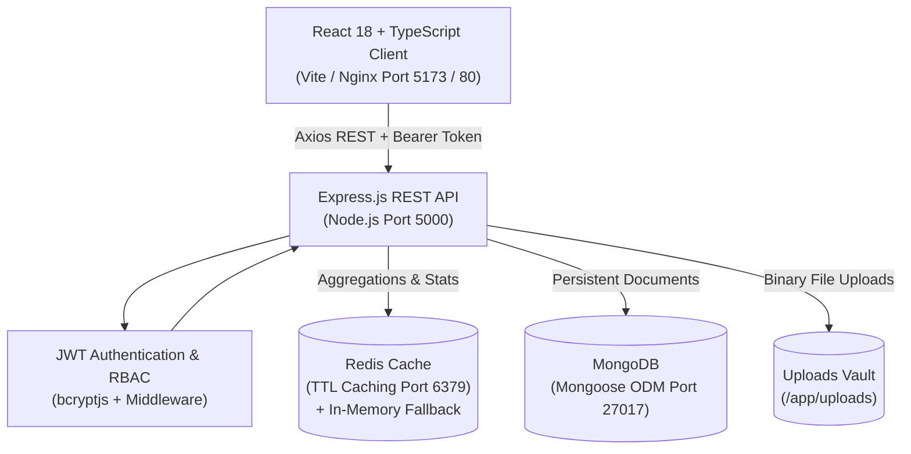

# Biotechnology IP Lifecycle Management and Compliance Platform (BioVault IP)

An enterprise-grade, full-stack web application designed for biotechnology and biopharmaceutical companies to centralize and automate intellectual property (IP) assets, invention disclosures, patent filings, licensing agreements, regulatory dossiers (FDA/EMA), biosafety compliance protocols, and multi-institutional research collaborations.

---

## Table of Contents
1. [Platform Overview](#platform-overview)
2. [Technology Stack](#technology-stack)
3. [User Roles & RBAC Matrix](#user-roles--rbac-matrix)
4. [System Architecture](#system-architecture)
5. [Core Modules](#core-modules)
6. [Folder Structure](#folder-structure)
7. [Environment Variables](#environment-variables)
8. [Installation & Setup](#installation--setup)
   - [Local Development (Native)](#local-development-native)
   - [Docker & Docker Compose](#docker--docker-compose)
9. [Database Seeding & Demo Credentials](#database-seeding--demo-credentials)
10. [REST API Documentation](#rest-api-documentation)
11. [Testing Suite](#testing-suite)
12. [Redis Caching & Resilient Fallback](#redis-caching--resilient-fallback)
13. [Future Enhancements](#future-enhancements)

---

## Platform Overview

Biotechnology enterprises face significant challenges tracking complex scientific disclosures across molecular biology, gene therapies, and oncology pipelines. **BioVault IP** provides an integrated compliance and lifecycle governance platform that bridges laboratory innovation with legal and regulatory execution:

- **Lifecycle Transition Automation**: Direct one-click conversion of vetted Technology Disclosures into formal Patent Applications.
- **Multijurisdictional Patent Management**: Detailed tracking across USPTO (US), EPO (Europe), WIPO (PCT), and JPO (Japan).
- **Proactive Deadline & Regulatory Alerting**: Unified countdowns for patent statutory expirations, FDA IND / EMA CTA submission targets, and biosafety facility audits.
- **Cross-Module Search Engine**: Global multi-entity search querying projects, patents, filings, disclosures, and agreements simultaneously.
- **Audit-Ready Regulatory Compliance**: Automated overdue tracking for BSL-2/3 containment, GLP toxicology data, and HIPAA genomic privacy.

---

## Technology Stack

### Frontend
- **Framework**: React.js 18 with TypeScript
- **Routing**: React Router v6
- **Styling**: Vanilla CSS3 Custom Enterprise Design System (Tokens, Glassmorphism, Micro-transitions, Responsive Grids)
- **HTTP Client**: Axios with Bearer JWT request/response interceptors
- **Icons**: Lucide React
- **Build Tool**: Vite 5

### Backend
- **Runtime & Framework**: Node.js v20+ with Express.js REST API
- **Language**: TypeScript
- **Security & Utilities**: Helmet, CORS, Morgan HTTP logger
- **Authentication**: JSON Web Tokens (`jsonwebtoken`) & `bcryptjs` password hashing
- **File Management**: Multer disk storage engine

### Database & Caching
- **Database**: MongoDB with Mongoose ODM (Schemas, References, Validations, and Text Indexes)
- **Caching Layer**: Redis v7 (with automated fallback to an in-memory TTL cache when Redis is offline)

### DevOps & Containerization
- **Containerization**: Docker (multi-stage builds) & Docker Compose
- **Web Server / Reverse Proxy**: Nginx (Production Frontend Container)

---

## User Roles & RBAC Matrix

The platform implements strict Role-Based Access Control on both frontend navigation and backend REST endpoints:

| Feature / Module | ADMIN | IP MANAGER | RESEARCHER |
| :--- | :---: | :---: | :---: |
| **Executive Dashboard & Analytics** | Full Access | Full Access | Full Access |
| **R&D Project Management** | Create / Edit / Delete | Create / Edit / Delete | View Assigned / All |
| **Patent Portfolio Management** | Create / Edit / Delete | Create / Edit / Delete | Read-Only |
| **Technology Invention Disclosures** | Review / Convert / Delete | Review / Convert / Delete | Submit & Edit Drafts |
| **Convert Disclosure to Patent** | Supported | Supported | Restricted |
| **Commercial Licensing Deals** | Create / Edit / Delete | Create / Edit / Delete | Read-Only |
| **Regulatory Filings (FDA / EMA)** | Create / Edit / Delete | Create / Edit / Delete | Read-Only |
| **Biosafety & GLP Compliance** | Create / Edit / Delete | Create / Edit / Delete | Read-Only |
| **Research Collaborations** | Create / Edit / Delete | Create / Edit / Delete | Create / Edit / View |
| **Document Vault Upload & Download** | Full Access | Full Access | Full Access |
| **User Directory & RBAC Governance** | Full Access | Restricted | Restricted |
| **System Diagnostics & Redis Status** | View Diagnostics | View Diagnostics | View Diagnostics |

---

## System Architecture



---

## Core Modules

1. **Authentication & Session Security**: JWT authentication with persistent session decoding, bcrypt 10-round salted password hashing, profile updates, and secure password modification.
2. **Executive Dashboard**: Real-time KPI summary cards, IP lifecycle stage funnel, compliance risk stratification, upcoming deadlines widget, and live audit trail.
3. **Project Management**: Full CRUD with statuses (*Planning, Active, On Hold, Completed, Archived*), priority tags, department categorization, and linked asset summaries.
4. **Patent Management**: Comprehensive claims recording, application statuses (*Draft, Filed, Under Examination, Granted, Rejected, Expired*), jurisdiction tagging (*USPTO, EPO, WIPO, JPO*), and expiration dates.
5. **Technology Disclosure Management**: Invention disclosure lifecycle (*Submitted &rarr; Under Review &rarr; Approved &rarr; Converted to Patent*). Includes one-click conversion generating a linked Patent record.
6. **Licensing Agreements**: Commercial deal tracking (*Exclusive, Non-Exclusive, Cross-License, Option*), licensee/licensor profiles, financial/royalty milestones, and expiration monitoring.
7. **Regulatory Filing Management**: Tracking dossiers across FDA, EMA, PMDA, and NMPA (*IND, NDA, BLA, CTA, Orphan Drug Designation*), with automatic overdue and upcoming highlights.
8. **Compliance Management**: Biosafety (BSL-2/3), GLP, GCP, and HIPAA tracking with dynamic overdue detection and risk stratification (*Critical, High, Medium, Low*).
9. **Research Collaboration**: Joint academic and consortium charters, partner institutions, lead scientists, duration, and IP terms.
10. **Document Management Vault**: Multi-part document upload mechanism associating files to any platform entity, metadata inspection, and secure downloads.
11. **Deadlines & Reminders Matrix**: Cross-module aggregation categorizing deadlines into *Overdue, Due Today, Due This Week, and Upcoming (30-90 Days)* with direct asset navigation.
12. **Global & Module Search**: Dedicated module filters plus a global modal search (`Ctrl+K`) that searches across all 7 business entities in real time.
13. **Executive Analytics & Reports**: Visual multi-dimensional reporting covering patent jurisdictions, project stage allocation, compliance risk profiles, and deal structures.
14. **User Administration (Admin Only)**: User directory inspection, real-time RBAC role modification, and account activation/deactivation.
15. **Profile & Platform Diagnostics**: Personal profile maintenance, password change, and live service health indicators (MongoDB status, Redis status, server timestamp).

---

## Folder Structure

```
FSD project/
├── backend/
│   ├── src/
│   │   ├── config/
│   │   │   ├── database.ts         # MongoDB connection & lifecycle events
│   │   │   └── redis.ts            # Redis client with resilient in-memory TTL fallback
│   │   ├── controllers/            # Controller logic for all 15 modules
│   │   ├── middleware/
│   │   │   ├── auth.ts             # JWT verification and RBAC authorization
│   │   │   ├── errorHandler.ts     # Global centralized Express error handling
│   │   │   └── upload.ts           # Multer file storage configuration
│   │   ├── models/                 # Mongoose schemas (User, Project, Patent, etc.)
│   │   ├── routes/                 # Express route definitions
│   │   ├── seed/
│   │   │   └── seed.ts             # Authentic biotechnology sample data seeder
│   │   ├── tests/
│   │   │   └── api.test.ts         # Integration test suite
│   │   ├── app.ts                  # Express application setup
│   │   └── server.ts               # Server bootstrap entrypoint
│   ├── uploads/                    # Local storage for uploaded files
│   ├── .env                        # Environment configuration
│   ├── Dockerfile                  # Multi-stage production backend container
│   ├── package.json
│   └── tsconfig.json
├── frontend/
│   ├── src/
│   │   ├── components/             # Reusable UI components (Modals, StatCards, Badges)
│   │   ├── context/
│   │   │   └── AuthContext.tsx     # Authentication context and persistent state
│   │   ├── layouts/
│   │   │   └── DashboardLayout.tsx # Main dashboard layout (Sidebar, Navbar, Viewport)
│   │   ├── pages/                  # Views for each platform module
│   │   ├── routes/
│   │   │   └── AppRoutes.tsx       # Route definitions and RBAC guards
│   │   ├── services/
│   │   │   └── api.ts              # Axios centralized API client
│   │   ├── styles/
│   │   │   └── index.css           # Global enterprise CSS design system
│   │   ├── types/
│   │   │   └── index.ts            # TypeScript interfaces
│   │   ├── App.tsx
│   │   └── main.tsx
│   ├── Dockerfile                  # Multi-stage frontend container with Nginx
│   ├── nginx.conf                  # Production reverse proxy configuration
│   ├── package.json
│   ├── tsconfig.json
│   └── vite.config.ts
├── docker-compose.yml              # Complete orchestration (Frontend, Backend, Mongo, Redis)
└── README.md
```

---

## Environment Variables

### Backend (`backend/.env`)
```env
PORT=5000
NODE_ENV=development
MONGODB_URI=mongodb://127.0.0.1:27017/biotech_ip_platform
JWT_SECRET=biotech_ip_platform_super_secret_jwt_key_2026_enterprise
JWT_EXPIRES_IN=7d
REDIS_URL=redis://127.0.0.1:6379
CORS_ORIGIN=http://localhost:5173
```

*(When running inside Docker Compose, `MONGODB_URI` points to `mongodb://mongodb:27017/biotech_ip_platform` and `REDIS_URL` points to `redis://redis:6379`)*.

---

## Installation & Setup

### Local Development (Native)

#### Prerequisites
- **Node.js** (v18 or higher)
- **MongoDB** (running locally on port 27017)
- **Redis** (optional; the platform automatically activates an in-memory TTL fallback if Redis is not running)

#### 1. Setup & Seed Backend
```bash
cd backend
npm install

# Seed the database with authentic biotechnology sample data
npm run seed

# Run the integration test suite
npm test

# Start the backend development server
npm run dev
```
Backend API will start on: `http://localhost:5000`  
Health check endpoint: `http://localhost:5000/api/health`

#### 2. Setup & Start Frontend
```bash
# In a separate terminal
cd frontend
npm install

# Build to verify TypeScript compilation
npm run build

# Start the Vite development server
npm run dev
```
Frontend web application will be accessible at: `http://localhost:5173`

---

### Docker & Docker Compose

To run the entire platform with MongoDB, Redis, the Node.js API, and the Nginx React frontend in isolated containers:

```bash
# From the project root
docker compose up -d --build
```

#### Services Spawned:
- **Frontend**: `http://localhost` (or `http://localhost:5173`)
- **Backend API**: `http://localhost:5000`
- **MongoDB**: `localhost:27017`
- **Redis**: `localhost:6379`

To seed the database inside the container:
```bash
docker exec -it biovault_backend npm run seed
```

To stop containers:
```bash
docker compose down
```

---

## Database Seeding & Demo Credentials

The platform includes a realistic biotechnology seed script featuring CRISPR CasX gene therapies, lipid nanoparticle mRNA vaccines, allogeneic CAR-NK immunotherapy, and oncology licensing deals.

To seed the database at any time, run:
```bash
cd backend
npm run seed
```

### Pre-Configured Demo Credentials:

| Role | Email Address | Password | Permissions Scope |
| :--- | :--- | :--- | :--- |
| **ADMIN** | `admin@biotech-ip.com` | `Password123!` | Complete administrative authority, user management, and all IP modules |
| **IP MANAGER** | `manager@biotech-ip.com` | `Password123!` | Management of patents, disclosures, licenses, and deadlines |
| **RESEARCHER** | `researcher@biotech-ip.com` | `Password123!` | Create disclosures, manage collaborations, and upload documentation |

*(The login screen also features 1-click **Quick Fill** buttons to conveniently populate these credentials).*

---

## REST API Documentation

All protected routes require an `Authorization: Bearer <token>` header.

### Authentication & Users
- `POST /api/auth/register` - Create user profile and obtain JWT
- `POST /api/auth/login` - Verify credentials and return JWT & user object
- `GET  /api/auth/me` - Retrieve authenticated user profile
- `PUT  /api/auth/profile` - Update display name and department
- `PUT  /api/auth/change-password` - Modify account password
- `GET  /api/users` - List all users *(Admin only)*
- `PUT  /api/users/:id` - Update user role or active status *(Admin only)*
- `DELETE /api/users/:id` - Remove user *(Admin only)*

### Projects
- `GET    /api/projects` - List projects with filtering, sorting, and search
- `GET    /api/projects/:id` - Get project dossier with linked asset count
- `POST   /api/projects` - Create project *(Admin, IP Manager)*
- `PUT    /api/projects/:id` - Update project *(Admin, IP Manager)*
- `DELETE /api/projects/:id` - Remove project *(Admin, IP Manager)*

### Patents
- `GET    /api/patents` - List patents with filters (status, jurisdiction, project)
- `GET    /api/patents/:id` - Get patent details
- `POST   /api/patents` - Register patent *(Admin, IP Manager)*
- `PUT    /api/patents/:id` - Update patent claims / status *(Admin, IP Manager)*
- `DELETE /api/patents/:id` - Delete patent record *(Admin, IP Manager)*

### Technology Disclosures
- `GET    /api/disclosures` - List invention disclosures
- `GET    /api/disclosures/:id` - Get disclosure dossier
- `POST   /api/disclosures` - Submit new invention disclosure *(All authenticated roles)*
- `PUT    /api/disclosures/:id` - Edit or review disclosure
- `POST   /api/disclosures/:id/convert-to-patent` - Convert approved disclosure to patent *(Admin, IP Manager)*
- `DELETE /api/disclosures/:id` - Remove disclosure *(Admin, IP Manager)*

### Licensing Agreements
- `GET    /api/agreements` - List licensing agreements and check expirations
- `GET    /api/agreements/:id` - Get agreement details
- `POST   /api/agreements` - Draft agreement *(Admin, IP Manager)*
- `PUT    /api/agreements/:id` - Update agreement terms *(Admin, IP Manager)*
- `DELETE /api/agreements/:id` - Terminate/delete agreement *(Admin, IP Manager)*

### Regulatory Filings
- `GET    /api/filings` - List filings with upcoming/overdue flags
- `GET    /api/filings/:id` - Get filing dossier
- `POST   /api/filings` - Record regulatory submission *(Admin, IP Manager)*
- `PUT    /api/filings/:id` - Update filing status *(Admin, IP Manager)*
- `DELETE /api/filings/:id` - Delete filing *(Admin, IP Manager)*

### Compliance
- `GET    /api/compliance` - List compliance items with dynamic overdue detection
- `GET    /api/compliance/:id` - Get compliance item
- `POST   /api/compliance` - Record requirement *(Admin, IP Manager)*
- `PUT    /api/compliance/:id` - Update compliance record *(Admin, IP Manager)*
- `DELETE /api/compliance/:id` - Remove requirement *(Admin, IP Manager)*

### Research Collaborations
- `GET    /api/collaborations` - List partnerships
- `GET    /api/collaborations/:id` - Get collaboration details
- `POST   /api/collaborations` - Record collaboration *(All authenticated roles)*
- `PUT    /api/collaborations/:id` - Update collaboration terms *(All authenticated roles)*
- `DELETE /api/collaborations/:id` - Remove collaboration *(Admin, IP Manager)*

### Document Vault
- `GET    /api/documents` - List uploaded files with metadata
- `POST   /api/documents/upload` - Upload file with entity association
- `GET    /api/documents/:id/download` - Stream physical file download
- `DELETE /api/documents/:id` - Delete record and disk file

### Deadlines & Analytics
- `GET    /api/deadlines` - Aggregated deadlines matrix *(Redis cached)*
- `GET    /api/dashboard/stats` - Consolidated executive metrics *(Redis cached)*
- `GET    /api/reports/statistics` - Multi-dimensional analytics *(Redis cached)*
- `GET    /api/search?q=:query` - Cross-entity search across all 7 core modules
- `GET    /api/health` - Infrastructure diagnostics (MongoDB, Redis, Node engine)

---

## Testing Suite

An automated integration test runner is located at `backend/src/tests/api.test.ts`. It spins up an ephemeral HTTP test server and validates:
1. Health & infrastructure endpoint
2. User registration and JWT issuance
3. Credential authentication & login
4. Protected route token decoding
5. RBAC security rejection for unauthorized requests (401)
6. Project creation, listing, and updates
7. Patent registration with relational project association
8. Compliance creation and automated overdue detection
9. Real aggregated dashboard statistics
10. Multi-module deadlines aggregation
11. Cross-module global search

To execute the test suite:
```bash
cd backend
npm test
```

---

## Redis Caching & Resilient Fallback

Redis is utilized for high-throughput dashboard calculations, deadlines lookahead calculations, and multi-dimensional report aggregations:
- **Cache Keys**: `stats:dashboard`, `stats:deadlines`, `stats:reports`, `cache:projects:all`, `cache:patents:all`
- **Cache Invalidation**: Mutations (`POST`, `PUT`, `DELETE`) on any resource invoke `invalidateAllDashboardCaches()`, ensuring data integrity.
- **Resilient Fallback Mode**: If Redis is offline, the backend catches the error, logs a notification, and transparently routes all caching through an in-memory TTL cache (`Map<string, { value: string, expiresAt: number }>`). The platform never throws 500 errors due to a missing Redis server.

---

## Future Enhancements
- **AI-Powered Prior Art Search**: Vector embeddings for technology disclosure abstracts compared against public PubMed and USPTO filings.
- **Direct CTIS & FDA ESG Integration**: Electronic transmission of XML eCTD regulatory dossiers directly to agency gateways.
- **Immutable Blockchain Notarization**: Cryptographic SHA-256 timestamping of laboratory notebooks on Hedera/Ethereum for undisputed priority date proof.
